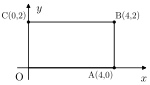

# 견본4 Codex 출제 보고서

작성일: 2026-11-04. 작업 지시서에 지정된 2·4·6·8·10·12·14·16·18번과 서답형1만 작성했다. 모든 문항에 `author='codex'`를 넣었다. 문항 파일 4개, 검증 파일 4개, 그림 1개를 작성했으며 기존 `CODEX_RUN_INFO.txt`는 수정하지 않았다.

## 검사 결과

- `verify_c1.py`부터 `verify_c4.py`까지 종료 코드 0, 마지막 출력 `ALL OK`.
- 견본4와 견본3의 `checkpart.py`로 네 파일을 각각 실행했다. 8회 모두 종료 코드 0이며 중복 금지 0개, 자료에 없는 어절 0개, 형식 표시 0개였다.
- 선택형 9문항의 지정 정답 번호, 다섯 선지의 서로 다름·등차성, 각 오답의 계산 근거를 확인했다. 서답형1은 4+6점과 두 답을 확인했다.
- 원문 10문항도 별도로 풀어 저장된 정답과 대조했다. 익스텐션·분석집 원문은 결과물에 옮기지 않았다.
- 16·18번과 서답형1의 조건 빼 보기에서 답이 달라지거나 정해지지 않는 반례를 확인했다.
- 14번 그림은 `figkit.py`와 대체 글꼴로 만들고 화면에서 축·좌표·영역 이름을 확인했다. PDF 빌드, git commit, git push는 실행하지 않았다.

| 번호 | 파일 | 원문 키 | 정답 | 골격 / 원문 유사도 | 중복 판정 |
|---|---|---|---|---|---|
| 2 | c1.py | M11 | ⑤ 4 | 0.638 / 0.423 | 주의(구조 유사) |
| 4 | c1.py | D54 | ④ 5 | 0.569 / 0.436 | 통과 |
| 6 | c1.py | J4 | ③ 32 | 0.523 / 0.306 | 통과 |
| 8 | c1.py | M13 | ① 3 | 0.587 / 0.306 | 통과 |
| 10 | c2.py | J69 | ③ 9 | 0.638 / 0.500 | 주의(구조 유사) |
| 12 | c2.py | I40 | ② 12 | 0.673 / 0.619 | 주의(구조 유사) |
| 14 | c2.py | J15 | ④ 6 | 0.273 / 0.120 | 통과 |
| 16 | c2.py | D61 | ⑤ 3 | 0.596 / 0.510 | 통과 |
| 18 | c3.py | I44 | ① 16 | 0.543 / 0.497 | 통과 |
| S1 | c4.py | J72 | (1) 4/3, (2) 2 | 0.554 / 0.496 | 통과 |

2·10·12번의 구조 유사 표시는 1–16번에 허용되는 범위이다. 16번의 골격 유사도는 소수 둘째 자리 표시에서 0.60으로 보이지만 금지 판정은 아니다. 구조 변경이 필수인 18번은 실제 수치가 0.60 미만이다.

## 문항별 전문·정답·변형 요약

### 2번 — M11

핵심: 반직선의 최솟값과 엄격부등호의 정수 경계. 출처: 2025년 수능특강 [25009-0110]. 출제 난도 표기: 하.

**문항 전문**

\(x\ge0\)인 모든 실수 \(x\)에 대하여 부등식
\[x^3-3x^2+9>a\]
가 성립하도록 하는 정수 \(a\)의 최댓값은?

① \(8\) / ② \(7\) / ③ \(6\) / ④ \(5\) / ⑤ \(4\)

**정답:** ⑤ \(4\)

**변형 요약:** [숫자 변경] 삼차식의 계수·상수항 변경, 엄격부등호와 정수 최댓값 유지

**원문 대비:** 원문의 최솟값 판정과 정수 경계 판단을 유지한 앞번호 기본 문항.

**풀이:**

\(f(x)=x^3-3x^2+9\)라 하면 \(f'(x)=3x(x-2)\)이다. \(x\ge0\)에서 \(f(x)\)의 최솟값은 \(f(2)=5\)이므로 \(a&lt;5\)이다. 따라서 정수 \(a\)의 최댓값은 \(4\)이다.

**빠른 풀이:** \(x^3-3x^2+9=(x-2)^2(x+1)+5\)이고 \(x\ge0\)에서 최솟값 \(5\)를 가지므로 \(a\)의 최댓값은 \(4\).

**오답 근거:** ① \(8\): 끝값 \(f(0)=9\)를 최솟값으로 보아 \(9-1\). ② \(7\): \(f(1)=7\)을 최솟값으로 보고 등호까지 허용. ③ \(6\): \(f(1)=7\)을 최솟값으로 보아 \(7-1\). ④ \(5\): 엄격부등호를 무시.

**검사:** `verify_c1.py` → `ALL OK`; `checkpart.py` → 종료 코드 0, 말투·형식 표시 0개. 골격 0.638, 원문 0.423, 주의(구조 유사). 최근접 자료 지문: `LIVE1-02-028`.

### 4번 — D54

핵심: 역함수 존재 조건에서 판별식의 등호 포함. 출처: 2012학년도 수능 9월 모의평가 나형 18번. 출제 난도 표기: 하.

**문항 전문**

정수 \(a\)에 대하여 함수 \(f(x)=\dfrac13x^3-ax^2+4ax\)의 역함수가 존재하도록 하는 \(a\)의 개수는?

① \(2\) / ② \(3\) / ③ \(4\) / ④ \(5\) / ⑤ \(6\)

**정답:** ④ \(5\)

**변형 요약:** [숫자·대상 변경] 일차항 계수 변경, 상수의 최댓값 → 정수 개수

**원문 대비:** 역함수 존재와 도함수의 부호를 연결하고 판별식의 등호를 판단한다.

**풀이:**

\(f'(x)=x^2-2ax+4a=(x-a)^2+4a-a^2\)이다. 역함수가 존재하려면 실수 전체에서 증가해야 하므로 \(4a-a^2\ge0\), 즉 \(0\le a\le4\)이다. 등호인 경우에도 도함수가 한 점에서만 \(0\)이므로 역함수가 존재한다. 가능한 정수는 \(0,1,2,3,4\)의 \(5\)개이다.

**빠른 풀이:** 도함수의 최솟값 \(4a-a^2\ge0\)에서 \(a=0,1,2,3,4\). 양 끝값도 포함한다.

**오답 근거:** ① \(2\): 판별식이 \(0\)인 두 경계만 셈. ② \(3\): \(0&lt;a&lt;4\)로 양 끝 제외. ③ \(4\): 정수 \(0\) 누락. ⑤ \(6\): \(0\)부터 \(5\)까지로 상한을 한 칸 늘림.

**검사:** `verify_c1.py` → `ALL OK`; `checkpart.py` → 종료 코드 0, 말투·형식 표시 0개. 골격 0.569, 원문 0.436, 통과. 최근접 자료 지문: `LIVE1-01-113`.

### 6번 — J4

핵심: 절댓값 합의 양수 부분 중 유계 영역 선택. 출처: 2024년 수능완성 [24054-0158]. 출제 난도 표기: 중.

**문항 전문**

함수 \(f(x)=x(x+2)(x-3)\)에 대하여 곡선 \(y=f(x)+|f(x)|\)와 \(x\)축으로 둘러싸인 부분의 넓이를 \(S\)라 할 때, \(3S\)의 값은?

① \(0\) / ② \(16\) / ③ \(32\) / ④ \(48\) / ⑤ \(64\)

**정답:** ③ \(32\)

**변형 요약:** [대상 변경] 넓이에서 미지수를 역산 → 양수 부분만 남는 그래프의 넓이

**원문 대비:** 원문의 절댓값 합에 의한 양수 부분 선택을 유지하고, 매개변수 계산을 덜었다.

**풀이:**

\(f(x)+|f(x)|\)는 \(f(x)\ge0\)에서 \(2f(x)\), \(f(x)&lt;0\)에서 \(0\)이다. 둘러싸인 부분은 \(-2\le x\le0\)에만 있으므로 \(S=2\displaystyle\int_{-2}^{0}(x^3-x^2-6x)\,dx=\dfrac{32}{3}\)이다. 따라서 \(3S=32\)이다.

**빠른 풀이:** 양수인 두 구간 중 \(x&gt;3\)에서는 둘러싸인 부분이 없다. \([-2,0]\)의 넓이만 두 배 한다.

**오답 근거:** ① \(0\): \(0&lt;x&lt;3\)에서만 넓이를 찾아 \(f+|f|=0\)으로 답함. ② \(16\): 계수 \(2\) 누락. ④ \(48\): 전개식의 \(-x^2\)항 누락. ⑤ \(64\): 이미 두 배 한 넓이를 다시 두 배 함.

**검사:** `verify_c1.py` → `ALL OK`; `checkpart.py` → 종료 코드 0, 말투·형식 표시 0개. 골격 0.523, 원문 0.306, 통과. 최근접 자료 지문: `LIVE2-04-064`.

### 8번 — M13

핵심: 두 양근·한 음근이 되는 수평선 높이. 출처: 2024년 수능완성 [24054-0132]. 출제 난도 표기: 중.

**문항 전문**

방정식 \(2x^3-6x-k=0\)이 서로 다른 두 양의 실근과 한 음의 실근을 갖도록 하는 정수 \(k\)의 개수는?

① \(3\) / ② \(4\) / ③ \(5\) / ④ \(6\) / ⑤ \(7\)

**정답:** ① \(3\)

**변형 요약:** [조건 변경] 양·음의 실근 개수의 곱 조건 → 두 양근·한 음근 조건, 삼차식 교체

**원문 대비:** 양근 두 개가 되는 높이 범위를 판단하며, 0과 접하는 높이는 제외한다.

**풀이:**

\(h(x)=2x^3-6x\)라 하면 \(h'(x)=6(x+1)(x-1)\)이고 극댓값은 \(h(-1)=4\), 극솟값은 \(h(1)=-4\)이다. \(h(0)=0\)이므로 두 양의 실근과 한 음의 실근을 가지는 조건은 \(-4&lt;k&lt;0\)이다. 따라서 \(k=-3,-2,-1\)의 \(3\)개이다.

**빠른 풀이:** 양의 구간에서 수평선이 두 번 만나려면 극솟값 \(-4\)와 \(h(0)=0\) 사이여야 한다.

**오답 근거:** ② \(4\): 경계 \(k=-4\) 또는 \(k=0\) 하나를 포함. ③ \(5\): 두 경계 모두 포함. ④ \(6\): 양근·음근의 개수를 바꾼 \(0&lt;k&lt;4\)도 포함. ⑤ \(7\): \(-4&lt;k&lt;4\)의 모든 정수를 셈.

**검사:** `verify_c1.py` → `ALL OK`; `checkpart.py` → 종료 코드 0, 말투·형식 표시 0개. 골격 0.587, 원문 0.306, 통과. 최근접 자료 지문: `GEN1-02-033`.

### 10번 — J69

핵심: 연결점의 가짜 방향 전환과 실제 방향 전환 구별. 출처: 2023학년도 수능 20번. 출제 난도 표기: 중상.

**문항 전문**

수직선 위를 움직이는 점 \(\mathrm{P}\)의 시각 \(t\,(t\ge0)\)에서의 속도 \(v(t)\)는 연속이다. 속도 \(v(t)\)와 가속도 \(a(t)\)가 다음 조건을 만족시킬 때, 시각 \(t=0\)에서 \(t=4\)까지 점 \(\mathrm{P}\)가 움직인 거리는?

(가) \(0\le t\le1\)일 때, \(v(t)=6t(t-1)\)이다.

(나) \(t&gt;1\)일 때, \(a(t)=6t-12\)이다.

① \(1\) / ② \(5\) / ③ \(9\) / ④ \(13\) / ⑤ \(17\)

**정답:** ③ \(9\)

**변형 요약:** [함수·조건 변경] 연결점에서 속도는 0이나 방향은 불변, 뒤 구간 내부에서 방향 전환

**원문 대비:** 연결점에서 가속도는 존재하지 않으므로 (나)의 범위는 \(t&gt;1\)로 두었다. 속도 연속 조건으로 적분상수를 정한다.

**풀이:**

\(v(1)=0\)이고 \(v(t)\)는 연속이므로 \(t&gt;1\)에서 \(v(t)=3t^2-12t+9=3(t-1)(t-3)\)이다. \(0&lt;t&lt;1\)과 \(1&lt;t&lt;3\)에서는 속도가 음수이고 \(t&gt;3\)에서는 양수이다. 따라서 움직인 거리는 \(-\displaystyle\int_0^1 6t(t-1)\,dt-\int_1^3 3(t-1)(t-3)\,dt+\int_3^4 3(t-1)(t-3)\,dt=1+4+4=9\)이다.

**빠른 풀이:** \(t=1\)에서는 속도가 0이지만 부호는 바뀌지 않는다. 세 구간의 이동거리는 차례로 \(1,4,4\).

**오답 근거:** ① \(1\): 변위 \(-1-4+4=-1\)의 절댓값. ② \(5\): \([1,3]\) 또는 \([3,4]\)의 이동거리 누락. ④ \(13\): 방향을 바꾸기 전 거리 \(4\)를 두 번 더함. ⑤ \(17\): \([1,4]\)에서 이미 절댓값 적분한 거리 \(8\)을 다시 두 배 함.

**검사:** `verify_c2.py` → `ALL OK`; `checkpart.py` → 종료 코드 0, 말투·형식 표시 0개. 골격 0.638, 원문 0.500, 주의(구조 유사). 최근접 자료 지문: `LIVE2-04-076`.

### 12번 — I40

핵심: 상수 구간 배제 및 적분 구간 밖의 연결점 선택. 출처: 2024년 수능특강 [24009-0153]. 출제 난도 표기: 중상.

**문항 전문**

두 상수 \(a\), \(b\)에 대하여 실수 전체의 집합에서 미분가능한 함수 \(f(x)\)의 도함수가
\[f'(x)=\begin{cases}a &(x&lt;b)\\ x^2-2x &(x\ge b)\end{cases}\]
이다. 함수 \(f(x)\)의 역함수가 존재하고 \(f(3)-f(0)=24\)일 때, \(a+b\)의 값은?

① \(14\) / ② \(12\) / ③ \(10\) / ④ \(8\) / ⑤ \(6\)

**정답:** ② \(12\)

**변형 요약:** [함수·조건 변경] 증가형 도함수와 큰 적분값으로 연결점이 적분 구간 밖에 있는 경우 선택

**원문 대비:** 구간 밖의 연결점과 상수 구간의 역함수 부재가 두 판단 지점이다. 도함수의 연속성을 일반적으로 가정하지 않고 각 조각의 원시함수로 연결한다.

**풀이:**

양쪽 식을 적분한 \(f(x)\)가 \(x=b\)에서 미분가능하므로 \(a=b^2-2b\)이다. 오른쪽에서 도함수가 양수이므로 역함수가 존재하려면 증가해야 한다. \(b&lt;2\)이면 오른쪽 조각에 감소 구간이 있고, \(b=2\)이면 왼쪽 조각이 상수이므로 \(b&gt;2\)이다. \(2&lt;b\le3\)일 때 \(f(3)-f(0)=\dfrac23b^3-b^2\le9\)이므로 조건에 맞지 않는다. 따라서 \(b&gt;3\)이고 \(3a=24\)에서 \(a=8\)이다. \(b^2-2b=8\)의 해 \(-2,4\) 중 \(b&gt;3\)인 것은 \(4\)이므로 \(a+b=12\)이다.

**빠른 풀이:** 연결점이 \([0,3]\) 안에 있으면 적분값은 최대 \(9\). 따라서 구간 전체에서 \(f\prime=a\), \(a=8\), \(b=4\).

**오답 근거:** ① \(14\): \(b(b-2)=8\)을 \(2(b-2)=8\)로 잘못 풀어 \(b=6\). ③ \(10\): \(a=8\)을 구한 뒤 연결점은 역함수 조건의 경계 \(b=2\)로 답함. ④ \(8\): \(a\)만 답함. ⑤ \(6\): 제외해야 하는 해 \(b=-2\)를 선택.

**검사:** `verify_c2.py` → `ALL OK`; `checkpart.py` → 종료 코드 0, 말투·형식 표시 0개. 골격 0.673, 원문 0.619, 주의(구조 유사). 최근접 자료 지문: `GEN2-03-074`.

### 14번 — J15

핵심: 역함수인 두 곡선의 대칭과 전체 넓이 활용. 출처: 학교 자체 출제. 출제 난도 표기: 중.

**문항 전문**

\(a&gt;3\)인 상수 \(a\)에 대하여 두 곡선 \(y=\dfrac{x^2}{a}\), \(x=\dfrac{y^2}{a}\)와 정사각형 \(\mathrm{OABC}\)가 그림과 같다.



세 부분의 넓이를 그림과 같이 \(S_1\), \(S_2\), \(S_3\)이라 할 때, \(S_3=2(S_1+S_2)\)를 만족시키는 \(a\)의 값은?

① \(3\) / ② \(4\) / ③ \(5\) / ④ \(6\) / ⑤ \(7\)

**정답:** ④ \(6\)

**변형 요약:** [자체 출제·함수 교체] 직선과 포물선 → 서로 역함수인 두 포물선, 등비 관계 → 가운데 넓이와 양 끝 넓이의 합

**원문 대비:** J15의 전체 넓이에서 두 쉬운 영역을 빼는 원리를 유지한다. 두 곡선의 대칭을 먼저 읽으면 가운데 영역을 직접 적분할 필요가 없다.

**풀이:**

그림에서 정사각형의 한 변은 \(3\)이고 두 곡선은 직선 \(y=x\)에 대하여 대칭이다. 따라서 \(S_1=S_2=\displaystyle\int_0^3\dfrac{x^2}{a}\,dx=\dfrac9a\)이다. \(S_3=9-\dfrac{18}{a}\)이므로 \(9-\dfrac{18}{a}=\dfrac{36}{a}\)에서 \(a=6\)이다. 이 값은 \(a&gt;3\)을 만족시킨다.

**빠른 풀이:** 전체 넓이 \(9\)는 \(3(S_1+S_2)\)이므로 \(S_1=S_2=\dfrac32\). \(9/a=3/2\)에서 \(a=6\).

**오답 근거:** ① \(3\): 조건을 \(S_3=S_1\)로 읽어 세 부분을 모두 같은 넓이로 둠. ② \(4\): 계수 \(2\)를 빠뜨려 \(S_3=S_1+S_2\). ③ \(5\): 전체 넓이에서 \(S_1\)을 빼지 않아 \(9-S_2=2(S_1+S_2)\). ⑤ \(7\): 전체 넓이에서 \(S_1\)을 두 번 빼어 \(9-2S_1-S_2=2(S_1+S_2)\).

**검사:** `verify_c2.py` → `ALL OK`; `checkpart.py` → 종료 코드 0, 말투·형식 표시 0개. 골격 0.273, 원문 0.120, 통과. 최근접 자료 지문: `LIVE2-03-177`.

### 16번 — D61

핵심: 좌우미분계수 곱과 영점·정지점 합집합의 중복 제거. 출처: 2016학년도 수능 9월 모의평가 A형 21번. 출제 난도 표기: 중상.

**문항 전문**

함수 \(f(x)=|(x+1)(x-1)^2(x-2)^2|\)에 대하여 부등식
\[\lim_{h\to0+}\frac{f(t+h)-f(t)}h\times\lim_{h\to0-}\frac{f(t+h)-f(t)}h\le0\]
을 만족시키는 모든 실수 \(t\)의 값의 합은?

① \(7\) / ② \(6\) / ③ \(5\) / ④ \(4\) / ⑤ \(3\)

**정답:** ⑤ \(3\)

**변형 요약:** [함수 교체·함정 추가] 사차식의 절댓값 → 두 겹친 영점을 갖는 오차식의 절댓값, 영점·도함수 영점의 중복 제거

**원문 대비:** 원문의 절댓값에 대한 좌우미분계수 판정을 보존하고 차수를 한 단계 올렸다. 두 영점에서 미분가능하다는 사실과 집합의 중복 제거를 함께 확인한다.

**풀이:**

\(P(x)=(x+1)(x-1)^2(x-2)^2\)라 하자. \(P(t)\ne0\)일 때 주어진 곱은 \(\{P'(t)\}^2\)이고, \(P(t)=0\)일 때에는 \(-\{P'(t)\}^2\)이다. 따라서 \(P(t)=0\) 또는 \(P'(t)=0\)이다. \(P'(x)=(x-1)(x-2)(5x^2-5x-4)\)이므로 가능한 값은 \(-1,1,2\)와 \(5t^2-5t-4=0\)의 서로 다른 두 실근이다. 이 두 근은 \(-1,1,2\)와 다르고 합은 \(1\)이므로 구하는 합은 \(-1+1+2+1=3\)이다.

**빠른 풀이:** 영점과 도함수의 영점의 합집합을 구한다. \(1,2\)는 두 번 더하지 않는다. 나머지 이차식의 두 근은 합만 구한다.

**오답 근거:** ① \(7\): 도함수의 영점의 합 \(4\)에 원래 식의 영점 개수 \(3\)을 더함. ② \(6\): 영점의 합 \(2\)와 도함수 영점의 합 \(4\)를 그대로 더함. ③ \(5\): \(1\)만 중복 제거하여 \(6-1\). ④ \(4\): 도함수의 영점만 셈으로써 꺾이는 점 \(t=-1\) 누락.

**검사:** `verify_c2.py` → `ALL OK`; `checkpart.py` → 종료 코드 0, 말투·형식 표시 0개. 골격 0.596, 원문 0.510, 통과. 최근접 자료 지문: `LIVE1-01-124`.

### 18번 — I44

핵심: 도함수의 실근 유형 분기와 같은 두 극솟값에서 사차식 복원. 출처: 2022년 수능특강 [22009-0158]. 출제 난도 표기: 최상.

**문항 전문**

세 실수 \(a\), \(b\), \(p\)에 대하여 함수 \(f(x)=x^4+ax^2+bx+1\)이 있다. 실수 \(t\)에 대하여 함수 \(|f(x)-t|\)가 미분가능하지 않은 점의 개수를 \(g(t)\)라 할 때, 다음 조건을 만족시키는 \(15\displaystyle\int_{-1}^1 f(x)\,dx\)의 값은?

(가) 함수 \(g(t)\)는 \(t=0\)과 \(t=p\)에서만 불연속이다.

(나) \(g(p)=2\)이다.

① \(16\) / ② \(26\) / ③ \(36\) / ④ \(46\) / ⑤ \(56\)

**정답:** ① \(16\)

**변형 요약:** [구조 변경: 설정 교체] 삼차함수·도함수의 적분 대칭 조건 → 삼차항이 없는 사차함수, 불연속 높이와 그 높이의 개수로 두 접점을 복원

**원문 대비:** 원문의 높이별 미분불가능점 개수 판정은 유지한다. 주어진 극점·적분 대칭으로 삼차함수의 계수를 정하는 단계는 삭제하고, 도함수의 실근 중복 분기 → 같은 두 극솟값 → 제곱인수 복원으로 교체했다. 최댓값·최솟값을 질문하지 않는다.

**풀이:**

\(|f(x)-t|\)는 \(f(x)=t\)이면서 \(f'(x)\ne0\)인 점에서만 미분가능하지 않다. 도함수가 서로 다른 실근을 하나만 가지면 불연속 높이는 최솟값 하나이고, 그 높이에서 \(g\)의 값은 \(0\)이다. 서로 다른 실근을 두 개 가지면 하나는 극점이 아닌 정지점이다. 최솟값에서 \(g\)의 값은 \(0\), 다른 정지점의 높이에서는 \(1\)이므로 (나)에 맞지 않는다. 따라서 도함수의 서로 다른 실근은 세 개이다. 두 극솟값이 다르면 두 극솟값과 극댓값의 세 높이에서 불연속이므로, (가)에 의하여 두 극솟값은 같다. 두 극솟값의 높이에서는 \(g=0\), 극댓값의 높이에서는 \(g=2\)이므로 (나)에 의하여 극댓값은 \(p\), 두 극솟값은 \(0\)이다. 서로 다른 두 극소점을 \(u,v\)라 하면 \(f(x)=(x-u)^2(x-v)^2\)이다. 삼차항의 계수가 \(0\)이므로 \(u+v=0\), 상수항이 \(1\)이므로 \(u^2v^2=1\)이다. 따라서 \(u,v=-1,1\)이고 \(f(x)=(x^2-1)^2\)이다. 실제로 \(p=1\), \(g(1)=2\)이다. 구하는 값은 \(15\displaystyle\int_{-1}^1(x^4-2x^2+1)\,dx=15\left(\dfrac25-\dfrac43+2\right)=16\)이다.

**빠른 풀이:** 불연속 높이 두 개만으로는 극점이 아닌 정지점의 경우가 남는다. \(g(p)=2\)가 이를 제외한다. 최솟값 \(0\)을 두 점에서 가지는 사차식은 두 제곱인수의 곱이고, 삼차항과 상수항에서 즉시 \((x^2-1)^2\)를 얻는다.

**오답 근거:** ② \(26\): \((x^2-1)^2\)의 전개에서 가운데 계수 \(2\)를 누락하여 \(x^4-x^2+1\)을 적분. ③ \(36\): 이차항을 빠뜨려 \(x^4+1\)을 적분. ④ \(46\): 가운데 항을 \(+x^2\)로 잘못 전개. ⑤ \(56\): 두 극소점을 실수로 갖는지 확인하지 않고 \((x^2+1)^2\)를 선택.

**검사:** `verify_c3.py` → `ALL OK`; `checkpart.py` → 종료 코드 0, 말투·형식 표시 0개. 골격 0.543, 원문 0.497, 통과. 최근접 자료 지문: `GEN2-03-086`.

### 서답형1 — J72

핵심: 위치와 이동거리의 기본 서술, 절댓값 적분의 부호 분할. 출처: 학교 자체 출제. 출제 난도 표기: 중.

**문항 전문**

시각 \(t=0\)일 때 원점을 출발하여 수직선 위를 움직이는 점 \(\mathrm{P}\)의 시각 \(t\,(t\ge0)\)에서의 속도는 \(v(t)=t^2-4t+3\)이다. 다음 물음에 답하시오.

(1) 시각 \(t=1\)에서 점 \(\mathrm{P}\)의 위치를 구하시오. [4점, 풀이과정을 상세히 쓰시오.]

(2) 시각 \(t=0\)에서 \(t=2\)까지 점 \(\mathrm{P}\)가 움직인 거리를 구하시오. [6점, 풀이과정을 상세히 쓰시오.]

**정답:** (1) \(\dfrac43\) / (2) \(2\)

**변형 요약:** [자체 출제·형식 변경] 매개변수별 보기 판정 → 고정된 이차 속도의 위치와 이동거리 단계 서술

**원문 대비:** J72의 위치·이동거리 구별을 4+6점 기본 서술로 나눴다. 매개변수의 여러 경우를 비교하는 부담은 없앴다.

**풀이:**

(1) 원점에서 출발하므로 위치는 \(\displaystyle\int_0^1(t^2-4t+3)\,dt=\left[\dfrac{t^3}{3}-2t^2+3t\right]_0^1=\dfrac43\)이다.

(2) \(v(t)=(t-1)(t-3)\)이므로 \(0\le t\le1\)에서 \(v(t)\ge0\), \(1\le t\le2\)에서 \(v(t)\le0\)이다. 움직인 거리는 \(\displaystyle\int_0^2|v(t)|\,dt=\int_0^1v(t)\,dt-\int_1^2v(t)\,dt=\dfrac43+\dfrac23=2\)이다.

**빠른 풀이:** 위치의 변화량은 \(2/3\)이지만 \(t=1\)에서 되돌아온다. 가장 멀리 간 위치 \(4/3\)까지의 거리와 되돌아온 거리 \(2/3\)를 더한다.

**오답 근거:** (1) 초기 속도 \(3\)을 위치로 답함. (2) 변위 \(2/3\)를 거리로 답함, 되돌아오는 부분을 빼먹어 \(4/3\), 구간 밖 \(t=3\)까지 적분하여 \(8/3\).

**채점 기준:**

- (1) 위치를 \(\displaystyle\int_0^1v(t)\,dt\)로 나타냄 [1점], 원시함수 \(t^3/3-2t^2+3t\) [1점], 양 끝 대입 및 계산 [1점], 위치 \(4/3\) 결론 [1점].
- (2) \(v(t)=(t-1)(t-3)\)과 구간 안의 영점 \(t=1\) [1점], \((0,1)\)에서 양수·\((1,2)\)에서 음수 확인 [1점], 거리를 절댓값 적분으로 정의 [1점], \(\int_0^1v-\int_1^2v\)로 분할 [1점], 두 구간 넓이 \(4/3,2/3\) 계산 [1점], 거리 \(2\) 결론 [1점].
- 구간 밖의 \(t=3\)까지 적분하거나 변위만 구한 경우 (2)의 거리 정의·분할·결론 점수는 주지 않는다. (1)의 계산 오류를 (2)에 일관되게 사용한 경우 올바른 정의·부호·분할 단계는 독립적으로 채점한다.

**검사:** `verify_c4.py` → `ALL OK`; `checkpart.py` → 종료 코드 0, 말투·형식 표시 0개. 골격 0.554, 원문 0.496, 통과. 최근접 자료 지문: `LIVE2-04-222`.

## 조건 빼 보기의 실제 출력

```text
ABLATION 16 함수식: 필요(f=x²이면 답 0, 원래 답 3)
ABLATION 16 좌우미분계수 곱 부등식: 필요(삭제하면 모든 실수 t가 허용되어 유한한 합이 정해지지 않음)
TRAP 16: <0이면 -1만, 절댓값을 벗기면 합 4, 중복을 제거하지 않으면 합 6
ABLATION 18 (가): 필요(f=x⁴+1, p=2이면 (나) 성립, 답 36)
ABLATION 18 (나): 필요(정지변곡 반례 g={-1: 0, 0: 0, 1: 2, 9/8: 1, 2: 2}, 답 36 - 5*sqrt(6))
ABLATION 18 최고차항 계수: 필요(2(x²-1/√2)²이면 답 42-20√2)
ABLATION 18 삼차항 계수: 필요((x-2)²(x-1/2)²이면 답 237/2)
ABLATION 18 상수항: 필요((x²-2)²이면 답 86)
ABLATION S1 원점 출발: 필요(초기 위치1이면 (1)은 7/3, 거리는2)
ABLATION S1 속도식: 필요(v=1이면 (1)은1, (2)는2)
BOUNDARY S1: 종료 시각3이면 거리8/3, 종료 시각2이면 거리2
```

18번의 `p>0`은 최종본에서 삭제했다. (가)(나)와 함수식에서 따라오는 성질이므로 별도 단서로 둘 필요가 없다. 조건 (나)를 빼면 정지변곡점이 있는 사차함수가 살아남으며, 이 반례의 답은 `36-5√6`으로 달라진다.

## 원문 정답 대조

| 원문 키 | 직접 계산한 원문 정답 | 저장된 정답 |
|---|---|---|
| M11 | 5 | ② |
| D54 | 3 | ① |
| J4 | 5/4 | ② |
| M13 | 25 | ⑤ |
| J69 | 17 | 17 |
| I40 | −1 | ② |
| J15 | 42 | 42 |
| D61 | 5 | ④ |
| I44 | 52 | ④ |
| J72 | ㄱ, ㄷ | ③ |

## 18번 구조 검토 메모와 별도 관문

출제자의 자체 점검: 원문의 “높이별 절댓값 함수의 미분불가능점 수로 정지점의 높이를 해석한다”는 판정 원리를 유지했다. 함수 교체는 삼차에서 사차로 한 겹이다. 원문의 주어진 극점·도함수 적분 대칭으로 계수를 정하는 설정을 없앴다. 새 풀이는 도함수 실근의 중복 유형 분류 → 같은 두 극솟값 판정 → 제곱인수 복원으로 진행한다. 다항함수 미분과 정적분이라는 평가 요소를 유지하며, 최댓값·최솟값 대신 정적분의 값을 묻는다.

기계 검사와 출제자의 자체 검토는 완료했다. 지침서 0-4의 별도 관문인 독립 검토자의 구조 거리 산정, Claude와 Codex의 블라인드 풀이 패널 및 학교 기준 문항 대비 시간·체감 난도 측정은 이번 실행에서 실시하지 않았다. 따라서 구조 거리나 실측 난도·시간을 통과했다고 주장하지 않는다. 이 항목들은 공동 출제의 교차 풀이 단계에서 확인해야 한다.

## 재현 명령

저장소 루트에서 다음 명령을 실행한다.

```bash
python3 output/build/기말/견본4/parts/verify_c1.py
python3 output/build/기말/견본4/parts/verify_c2.py
python3 output/build/기말/견본4/parts/verify_c3.py
python3 output/build/기말/견본4/parts/verify_c4.py
cd output/build/기말/견본4
python3 checkpart.py parts/c1.py
python3 checkpart.py parts/c2.py
python3 checkpart.py parts/c3.py
python3 checkpart.py parts/c4.py
```


## 조정

2026-11-04, `공동출제/견본4_codex.md` D단계 지시에 따라 **14·16번만 조정**했다. 앞 절의 14·16번 전문·정답·검사 수치는 최초 출제 기록이며, **현재 문항은 이 절의 내용으로 대체한다.** 수정 파일은 `c2.py`, `verify_c2.py`, `fig_c_14.svg`, 이 보고서뿐이다. 같은 파일의 10·12번을 포함한 다른 문항과 Claude 파일은 수정하지 않았다.

| 번호 | 정답 | 선지 | 난도 표기 | 예상 체감 / 시간 | 골격 / 원문 유사도 |
|---|---|---|---|---|---|
| 14 | ④ 9 | 6, 7, 8, 9, 10 | 중상 | 5.0/10 · 2.4분 | 0.27 / 0.04 |
| 16 | ⑤ 4 | 0, 1, 2, 3, 4 | 상 | 7.0/10 · 4.4분 | 0.44 / 0.38 |

체감·시간은 추가한 판단 단계에 따른 출제자 예상이며, 이번 조정 뒤의 블라인드 실측값은 아니다. 지정된 정답 번호 ④·⑤를 유지했고 두 문항 모두 공차 1이다.

### 조정 14번 — J15

**문항 전문**

\(a>2\)인 상수 \(a\)에 대하여 두 곡선 \(y=\dfrac{x^2}{a}\), \(x=\dfrac{y^2}{a}\)과 그림과 같은 직사각형 \(\mathrm{OABC}\)가 있다.

직사각형 \(\mathrm{OABC}\)에서 두 부등식
\[ax\le y^2,\qquad ay\le x^2\]
을 만족시키는 부분의 넓이를 각각 \(S_1\), \(S_2\)라 할 때, 직사각형 \(\mathrm{OABC}\)의 넓이가 \(3(S_1+S_2)\)이 되도록 하는 \(a\)의 값은?

① \(6\) / ② \(7\) / ③ \(8\) / ④ \(9\) / ⑤ \(10\)

**정답:** ④ \(9\)

**변형 요약:** [도형·조건 변경·함정 추가] 정사각형 → 가로 4, 세로 2인 직사각형, 곡선이 윗변과 만나는 경우를 넓이 조건으로 배제한 뒤 적분

**풀이:** 두 곡선의 원점 이외의 교점은 \((a,a)\)이고 \(a&gt;2\)이므로 직사각형 내부에서 두 부분은 겹치지 않는다. 전체 넓이가 \(8\)이므로 \(S_1+S_2=\dfrac83\)이다. \(2&lt;a\le8\)이면 \(0\le x\le4\)에서 \(\dfrac{x^2}{a}\ge\dfrac{x^2}{8}\)이므로 \(S_2\ge\displaystyle\int_0^4\dfrac{x^2}{8}\,dx=\dfrac83\)이다. \(S_1&gt;0\)이므로 이 경우는 불가능하다. 따라서 \(a&gt;8\)이고, \(S_1=\displaystyle\int_0^2\dfrac{y^2}{a}\,dy=\dfrac8{3a}\), \(S_2=\displaystyle\int_0^4\dfrac{x^2}{a}\,dx=\dfrac{64}{3a}\)이다. \(\dfrac{24}{a}=\dfrac83\)에서 \(a=9\)이고, 이는 \(a&gt;8\)을 만족시킨다.

**빠른 풀이:** \(S_1+S_2=8/3\). \(a\le8\)이면 아래쪽 부분만으로도 넓이가 \(8/3\) 이상이므로 \(a&gt;8\). 두 넓이의 합 \((2^3+4^3)/(3a)=24/a\)에서 \(a=9\).

**오답 근거:** ① \(6\): 전체 넓이를 \(2(S_1+S_2)\)로 잘못 두고 \(24/a=4\). ② \(7\): \(\int_0^4x^2\,dx\)를 \(4^2=16\)으로 잘못 계산하여 \((8/3+16)/a=8/3\). ③ \(8\): \(S_1\)을 빠뜨려 \(S_2=8/3\). ⑤ \(10\): \(S_1\)을 두 번 더해 \(2S_1+S_2=8/3\).

**원문·이전 문항 대비:** J15의 전체 넓이에서 두 부분을 빼는 원리와 두 역함수 곡선은 유지한다. 대칭에 의한 넓이 일치를 없애고, \(a=8\)을 경계로 아래쪽 넓이의 적분식이 달라짐을 판단하게 했다. 그림에는 직사각형만 제시하여 곡선과 변의 위치 관계를 미리 알려 주지 않는다.

### 조정 16번 — D61

**문항 전문**

상수 \(a\)에 대하여 함수 \(f(x)=|(x+1)^3(x-3)+a|\)가 있다. 부등식
\[\lim_{h\to0+}\frac{f(t+h)-f(t)}h\times\lim_{h\to0-}\frac{f(t+h)-f(t)}h\le0\]
을 만족시키는 서로 다른 실수 \(t\)의 개수가 \(3\)일 때, 이 실수 \(t\)의 값의 합은?

① \(0\) / ② \(1\) / ③ \(2\) / ④ \(3\) / ⑤ \(4\)

**정답:** ⑤ \(4\)

**변형 요약:** [조건 변경·함수 교체·함정 추가] 고정된 오차식 → 수직이동하는 사차식, 해의 개수로 매개변수 결정, 극값이 아닌 정지점과 겹친 영점의 경계 구분

**풀이:** \(P(x)=(x+1)^3(x-3)+a\)라 하자. \(P(t)\ne0\)일 때 주어진 곱은 \(\{P'(t)\}^2\)이고, \(P(t)=0\)일 때에는 \(-\{P'(t)\}^2\)이다. 따라서 \(P(t)=0\) 또는 \(P'(t)=0\)이다. \(P'(x)=4(x+1)^2(x-2)\)이므로 \(t=-1,2\)는 항상 해이다. \(P\)는 \(x&lt;2\)에서 감소하고 \(x&gt;2\)에서 증가하며, \(P(-1)=a\), \(P(2)=a-27\)이다. \(a&lt;27\)이면 \(P(x)=0\)의 서로 다른 실근은 두 개이다. 이 중 \(-1\)과 겹치는 경우는 \(a=0\)뿐이므로 해의 개수는 \(a=0\)일 때 \(3\), 나머지는 \(4\)이다. \(a=27\)이면 유일한 영점 \(2\)가 도함수의 영점과 겹쳐 해는 \(-1,2\)뿐이고, \(a&gt;27\)일 때에도 해는 \(-1,2\)뿐이다. 따라서 \(a=0\)이고, 가능한 \(t\)는 \(-1,2,3\)이므로 구하는 합은 \(4\)이다.

**빠른 풀이:** 도함수의 서로 다른 영점은 항상 \(-1,2\). 해가 \(3\)개이려면 \(P\)의 두 영점 중 하나만 이들과 겹쳐야 한다. \(a=27\)에서는 영점이 \(2\) 하나뿐이므로 제외하고, \(a=0\)에서 \(\{-1,2,3\}\)을 얻는다.

**오답 근거:** ① \(0\): \(a=0\)에서 사차방정식의 근을 겹친 횟수대로 세어 \(-1-1-1+3\)만 구함. ② \(1\): \(a=27\)에서 영점 \(2\)를 도함수의 영점과 별개로 세어 해가 \(3\)개라고 판단하고 \(-1+2\)를 답함. ③ \(2\): \(a=0\)에서 \(P(t)=0\)인 \(-1,3\)만 더함. ④ \(3\): \(a=0\)에서 \(P(t)=0\)의 해와 \(P\prime(t)=0\)의 해를 그대로 더하여 \((-1+3)+(-1+2)\).

**원문·이전 문항 대비:** 좌·우미분계수 곱의 판정은 유지한다. \(a\ne0\)일 때 \(x=-1\)은 극값을 갖는 점이 아니지만 곱이 \(0\)이므로 반드시 센다. \(a=0,27\)의 두 경계에서는 겹친 영점을 한 번만 세어야 한다.

### 추가 판단과 검증 근거

14번은 두 역함수 곡선과 넓이 조건을 유지하면서 한 변 3인 정사각형을 가로 4, 세로 2인 직사각형으로 바꿨다. 두 부분을 부등식으로 정의해 곡선이 만나는 변을 미리 지정하지 않았다. 그림에도 직사각형과 좌표만 표시했다. 따라서 대칭만으로 두 넓이를 같게 둘 수 없고, \(a=8\)에서 적분 범위가 달라지는지 판단해야 한다. 전체 넓이와 두 부분의 합의 관계는 기존의 \(S_3=2(S_1+S_2)\)와 동등하다.

검증에서는 \(S_1=8/(3a)\)와 함께 실제 아래쪽 넓이를 다음 두 경우로 계산했다.

\[
S_2=\begin{cases}
8-\dfrac43\sqrt{2a}&(2<a\le8),\\[2pt]
\dfrac{64}{3a}&(a>8).
\end{cases}
\]

첫 경우에서 \(u=\sqrt{2a}\)로 놓으면 \(2<u\le4\)이고,

\[
S_1+S_2-\frac83=\frac{4(4-u)}3+\frac{16}{3u^2}>0
\]

이므로 모든 매개변수를 배제할 수 있다. 둘째 경우에서는 유일한 해 \(a=9\)를 얻는다. 풀이에는 이 계산을 길게 쓰지 않고 경계 \(a=8\)의 넓이와 비교하는 방법을 실었다. 오답 6·7은 잘못된 넓이식을 일률적으로 적용한 결과이고 \(a>8\) 검사도 놓친 값이다. 오답 8은 작은 부분 누락, 10은 작은 부분 중복 합산이다.

16번은 고정된 식의 영점을 찾던 문항에 수직이동 매개변수와 해의 개수 조건을 더했다. 원문의 핵심인 좌·우미분계수 곱의 부호 판정은 그대로 사용한다. \(P(x)=(x+1)^3(x-3)+a\)일 때 \(P'(x)=4(x+1)^2(x-2)\)이므로, 극값 여부와 관계없이 \(-1,2\)를 항상 후보로 넣어야 한다.

| \(a\)의 범위 | \(P=0\)의 서로 다른 실근 수 | \(P'=0\)과 겹치는 근 | 부등식의 해 개수 |
|---|---|---|---|
| \(a<0\) | 2 | 없음 | 4 |
| \(a=0\) | 2 | \(-1\) | 3 |
| \(0<a<27\) | 2 | 없음 | 4 |
| \(a=27\) | 1 | \(2\) | 2 |
| \(a>27\) | 0 | 없음 | 2 |

증감과 최솟값으로 실수 전체의 경우를 확인하고, 판별식 \(256a^2(a-27)\)의 경계 및 각 구간의 Sturm 실근 수로 대조했다. \(a=0,1,27\)의 주요 후보에서 좌우 차분몫의 극한도 직접 계산했다. 특히 \(a=1,\ t=-1\)은 극값이 아닌 정지점이고, \(a=27,\ t=2\)는 두 번 겹친 영점이지만 두 경우 모두 곱이 0이다.

16번 조건 빼 보기 결과는 모두 '필요'이다.

- 함수식 삭제: \(f(x)=|x^2-1|\)은 같은 부등식의 해가 3개지만 합은 0이다.
- 해의 개수 조건 삭제: \(a=27\)도 허용되며 해의 합이 1로 달라진다.
- 미분계수 곱 부등식 삭제: 모든 실수 \(t\)가 허용되어 해 3개 및 유한한 합을 정할 수 없다.
- 등호 함정 추가 확인: \(\le0\)을 \(<0\)으로 바꾸면 모든 매개변수 범위에서 해가 최대 2개이므로 주어진 개수 조건을 만족할 수 없다.

### 조정 후 검사 결과

- verify_c2.py: 종료 코드 0, 마지막 줄 ALL OK. 14·16번의 정답·유일성·지정 정답 번호·등차 배열·오답 4개의 계산값을 확인했다. wrong에 적힌 선지 번호와 수치도 실제 선지와 대조했다. 원문 J15는 42, D61은 ④ 5로 직접 검산했다.
- verify_c1.py, verify_c3.py, verify_c4.py: 각각 종료 코드 0, 마지막 줄 ALL OK.
- 견본4의 checkpart.py로 c1.py부터 c4.py까지 검사하여 모두 종료 코드 0. 중복 금지 0개, 자료에 없는 어절 0개, 형식 표시 0개.
- 견본3의 checkpart.py로 ../견본4/parts/c2.py를 검사한 결과도 동일하게 통과했다. 기존 10·12번의 구조 유사 표시는 허용 범위이며 문항 내용은 바꾸지 않았다.
- 조정 문항 중복 결과: 14번 골격 0.27·원문 0.04, 최근접 지문 LIVE2-03-177; 16번 골격 0.44·원문 0.38, 최근접 지문 LIVE1-01-124. 모두 통과.
- 14번 SVG는 figkit.py와 대체 글꼴로 다시 그렸다. 원점·축·세 꼭짓점 좌표를 이미지로 확인했다. 곡선의 위치를 제시하지 않아 분기 판단을 남겼다.
- git diff --check 통과. PDF 빌드, git commit, git push는 실행하지 않았다.

## 18번 다시 쓰기

작성일: 2026-11-04. 이번 작업 지시서 `공동출제/견본4_codex.md`의 배정은 **18번만**이다. `c3.py`, `verify_c3.py`를 수정하고 이 절을 덧붙였다. 위의 최초 18번 전문·검사 기록은 이 절의 최종안으로 대체한다. 다른 문항과 그림은 수정하지 않았다.

### 문항 전문

최고차항의 계수가 \(1\)인 사차함수 \(f(x)\)와 실수 \(p\)가 있다. 실수 \(t\)에 대하여 함수 \(|f(x)-t|\)가 미분가능하지 않은 점의 개수를 \(g(t)\)라 하자. 두 함수 \(f(x)\), \(g(t)\)가 다음 조건을 만족시킬 때, \(15\displaystyle\int_{-1}^1 f(x)\,dx\)의 값은?

(가) 함수 \(g(t)\)가 \(t=a\)에서 불연속이 되도록 하는 모든 실수 \(a\)의 집합은 \(\{0,\ p\}\)이다.

(나)
\[\displaystyle\lim_{t\to p+}g(t)=g(p)\]
이다.

(다) 함수 \(f(x)\)는
\[f(-1)+f(1)=0\]
을 만족시킨다.

① \(16\) / ② \(26\) / ③ \(36\) / ④ \(46\) / ⑤ \(56\)

**정답: ① 16.** 유일한 함수는 \(f(x)=(x^2-1)^2\)이고 \(p=1\)이다.

### 전문 요약·변형과 풀이

일반적인 최고차항 계수 1의 사차함수에서 출발한다. (가)의 불연속점 집합과 (나)의 우극한 일치 조건으로 두 극솟값이 0임을 판정하고, (다)의 합 조건을 비음수성과 결합해 두 극소점을 결정한다. 기존 초안의 삼차항 계수 0과 상수항 1을 본문에 미리 고정하는 방식을 없앴다.

\(|f(x)-t|\)가 미분가능하지 않은 점은 \(f(x)=t\)이고 \(f'(x)\ne0\)인 점이다. 도함수의 실근 유형을 모두 나누면 다음과 같다. 표의 순서쌍은 해당 높이에서의 \((g(t),\lim_{s\to t+}g(s))\)이다.

| 도함수의 실근 유형 | 불연속 높이와 개수 | 판정 |
|---|---|---|
| 단순 실근 하나 또는 세 번 겹친 실근 하나 | 유일한 극솟값에서 \((0,2)\) | (나)에 모순 |
| 두 번 겹친 실근과 단순 실근 | 극솟값 \((0,2)\), 극점이 아닌 정지점의 높이 \((1,2)\) | (나)에 모순 |
| 서로 다른 실근 셋, 두 극솟값이 다름 | 두 극솟값과 극댓값, 총 세 높이 | (가)에 모순 |
| 서로 다른 실근 셋, 두 극솟값이 같음 | 극솟값 \((0,4)\), 극댓값 \((2,2)\) | 유일하게 가능 |

(가)에서 \(p=0\)인 한 점 집합도 미리 배제하지 않았으며, 이 경우 역시 (나)를 만족시키지 못한다. 가능한 마지막 경우에서는 (나)에 의해 극댓값이 \(p\), (가)에 의해 두 극솟값이 0이다. 따라서 \(f(x)\ge0\)이고 (다)에서 \(f(-1)=f(1)=0\)이다. 두 점 모두 극소점이므로
\[f(x)=(x+1)^2(x-1)^2.\]
따라서
\[15\int_{-1}^1 f(x)\,dx=15\left(\frac25-\frac43+2\right)=16.\]

원문 I44의 평가 요소인 높이별 미분불가능점의 개수와 그 불연속 판정 원리를 유지했다. 설정은 삼차함수에서 일반 사차함수로 한 겹 교체했다. 원문의 적분 대칭으로 계수 결정 → 주어진 정지점으로 계수 결정 → 상수 결정 과정은 사용하지 않는다. 새 단계는 정지점 유형·우극한 비교 → 같은 두 극솟값 판정 → 비음수 합으로 접점 복원이다. 원문 개념을 유지하는 공통 사실과 최종 정적분 계산은 남지만, 계수를 정하는 핵심 풀이 단계는 바뀌었다.

출제 난도 표기는 `상`이며 판단을 중심으로 구성했다. 체감 난도 6–7/10, 상위권 6–8분을 설계 목표로 삼았으나 이는 출제자 예상이다. 독립 구조 검토와 블라인드 풀이 패널의 실측 결과로 표시하지 않는다.

### 조건별 빼 보기

각 반례의 정지점 높이와 그 사이 모든 구간에서 단순 실근 수를 정확히 계산하여, 삭제하지 않은 조건의 성립까지 확인했다.

| 삭제한 조건 | 반례와 \(p\) | 남은 조건 확인 | 바뀐 답 |
|---|---|---|---|
| (가) 불연속점 집합 | \(f(x)=x^4-1,\ p=1\) | \(g\)는 \(t=1\) 근방에서 2로 일정, \(f(-1)+f(1)=0\) | \(-24\) |
| (나) 우극한 일치 | \(f(x)=x^4-x^2,\ p=-\tfrac14\) | 불연속점은 \(0,-\tfrac14\), \(f(-1)+f(1)=0\); \(g(p)=0\), 우극한 4 | \(-4\) |
| (다) 함수값의 합 | \(f(x)=(x^2-2)^2,\ p=4\) | 불연속점은 \(0,4\), \(g(4)=2\)이고 우극한도 2 | \(86\) |
| 본문 최고차항 계수 1 | \(f(x)=2(x^2-1)^2,\ p=2\) | (가)(나)(다) 모두 성립 | \(32\) |
| 본문 사차함수 | \(f(x)=(x^2-1)^4,\ p=1\) | 최고차항 계수 1과 (가)(나)(다) 모두 성립 | \(\tfrac{256}{21}\) |

세 상자 조건과 두 본문 조건 모두 `필요`이다. (나)를 빼면 극솟값이 음수이고 극댓값이 0인 경우가 남으므로, \(p\)에 양수 조건을 추가하지 않았다.

### 선지와 오답 근거

선지는 \(16,26,36,46,56\)으로 공차 10이다. 네 오답은 각각 \(x^4-x^2+1\), \(x^4+1\), \(x^4+x^2+1\), \((x^2+1)^2\)를 같은 구간에서 적분하고 15배 한 값이다. 가운데 항의 계수 누락, 이차항 누락, 부호·계수 오류, 두 실수에서의 최솟값 조건 누락에 대응한다. `wrong` 필드의 네 선지 수치도 실제 계산값과 대조했다.

### 원문 대비 길이

길이는 **HTML 태그와 공백을 제거하고 수식 소스 및 (가)(나)(다) 라벨을 포함**하여 센다. 이 방식은 작업 지시서의 원문 301자를 그대로 재현한다. 선지·해설은 제외한다.

| 항목 | 원문 I44 | 재작성 18번 |
|---|---|---|
| 길이 | 301자 | **305자** |
| 조건 수 | 3개 | **3개** |
| 길이 비율 | 100% | **101.3%** |

검증 스크립트에서 원문 301자, 새 문항 301–330자, 세 조건 라벨을 직접 검사한다.

### 검사 결과

- `python3 output/build/기말/견본4/parts/verify_c3.py`: 종료 코드 0, 마지막 줄 **ALL OK**.
- 일반 사차함수 전수 분류: 도함수의 실근 유형 전체를 분기했다. 극점 셋인 경우에는 양수인 두 인접 간격을 기호로 두고 두 극솟값의 차를 인수분해하여 같음·다름을 모두 다뤘다. 유한 개의 계수 표본 탐색으로 유일성을 주장하지 않았다.
- 남은 함수 \((x-u)^2(x-v)^2\)의 두 영점 조건을 SymPy로 풀어 \((u,v)=(-1,1),(1,-1)\)만 남고 같은 다항식 하나가 됨을 확인했다.
- 원문 I44를 별도로 풀어 정적분값 52를 얻고, 저장된 정답 번호 ④ 및 그 선지값 52와 대조했다.
- 견본4에서 `python3 checkpart.py parts/c3.py`: 종료 코드 0, **중복 금지 0개·자료에 없는 어절 0개·형식 표시 0개**.
- 견본3에서 `python3 checkpart.py ../견본4/parts/c3.py`: 동일하게 통과.
- 최근접 자료 지문 `GEN2-03-086`(동률 `LIVE2-03-155`): **골격 0.362244898 < 0.60**, 원문 포함도 0.336585366. 중복 판정 `통과`.
- `git diff --check`: 통과. PDF 빌드, git commit, git push는 실행하지 않았다.
