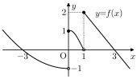

# 17번 블라인드 출제 보고서

## 문항 전문

함수 \(y=f(x)\)의 그래프가 그림과 같다.



두 실수 \(a\), \(b\)에 대하여 함수
\[
g(x)=\{f(x)\}^2+af(x)+b
\]
가 다음 조건을 만족시킬 때, \(a+b\)의 최댓값은? [5.2점]

> (가) 방정식 \(g(x)=0\)의 서로 다른 실근의 개수는 \(5\)이다.
>
> (나) \(g(0)+g(1)=0\)이다.

① \(-3\)　② \(-2\)　③ \(-1\)　④ \(0\)　⑤ \(1\)

**정답: ③ \(-1\)**

## 풀이

\(P(t)=t^2+at+b\)라 하자. 그림에서 \(f(0)=1,f(1)=2\)이므로 (나)는
\[
5+3a+2b=0
\]
이고, \(a+b=(b-5)/3\)이다. 한편 \(f(x)=t\)의 서로 다른 실근의 개수는 다음과 같다.

| 높이 \(t\) | 실근 개수 \(N(t)\) |
|---|---:|
| \(t\le-1\) | 1 |
| \(-1<t\le0\) | 2 |
| \(0<t\le1\) | 3 |
| \(1<t\le2\) | 2 |
| \(t>2\) | 1 |

\(P(3/2)=-1/4\)이므로 \(P\)의 두 실근을 \(r,s\)라 하면 \(r<3/2<s\)로 둘 수 있다. 근과 계수의 관계를 (나)에 대입하면
\[
2rs-3r-3s+5=0,\qquad s=\frac{3r-5}{2r-3}.
\]
따라서 \(r\le1\)이면 \(3/2<s\le2\), \(1<r<3/2\)이면 \(s>2\)이다.

| 작은 근 \(r\) | \(N(r)+N(s)\) |
|---|---:|
| \(r\le-1\) | 3 |
| \(-1<r\le0\) | 4 |
| \(0<r\le1\) | 5 |
| \(1<r<3/2\) | 3 |

그러므로 (가)는 \(0<r\le1\)과 동치이다. 이때 \(0<b=rs\le2\)이고, \(r=1,s=2\)이면 \(a=-3,b=2\)로 두 조건을 모두 만족시킨다. 따라서
\[
a+b=\frac{b-5}{3}\le-1
\]
이며 등호가 성립하므로 최댓값은 \(-1\)이다.

가능한 해는 유한 개 후보가 아니다. \(0<r\le1\)에서
\[
b(r)=\frac{r(3r-5)}{2r-3},\qquad
b'(r)=\frac{3\{2(r-3/2)^2+1/2\}}{(2r-3)^2}>0
\]
이므로 \(b\)는 연속적으로 \((0,2]\)를 움직인다. 이 미분 계산은 연속 자유도의 검증용이며, 학생 풀이에는 필요하지 않다.

## 원문 직접 풀이

- **설정:** 불연속점과 영점이 표시된 조각함수 \(f\)의 그래프와 최고차항 계수가 1인 독립적인 삼차함수 \(g\).
- **판정 원리:** 구간 전체에서 \(g/f\)의 극한이 존재하도록 불연속점에서 분자의 영점과 소멸 차수를 정한다.

원문의 삼차함수를 \(G\)라 쓰면, \(x=0\)에서 분모의 좌우 극한은 \(-1,1\)이므로
\(-G(0)=G(0)\), 즉 \(G(0)=0\)이다.

\(x=1\)에서 좌분모는 0으로, 우분모는 2로 수렴한다. 유한한 좌극한이 존재하려면 \(G(1)=0\)이고, 따라서 우극한은 0이다. 가운데 삼차 조각의 세 근이 서로 다르므로 1은 단순근이다. 좌극한도 0이 되려면 \(G'(1)=0\)이어야 한다.

최고차항 계수가 1이므로 \(G(x)=x(x-1)^2\)이다. 이 함수는 두 불연속점의 극한 조건을 만족한다. 그림에서 \((-3,3)\)의 그 밖의 점에서는 분모가 0이 아닌 연속함수이므로 추가 조건이 없다. 따라서
\[
G(3)=3(3-1)^2=12.
\]

## 검증 결과

실행 명령: `python3 verify17.py`

실행 결과: 종료 코드 0, 마지막 줄 `ALL OK`.

- 높이 구간 5개씩의 조합 25개를 SymPy의 정확한 부등식 풀이와 집합 교집합으로 조사했다. 가능한 네 경우가 매개변수 전체를 덮는다.
- 두 조건을 만족하는 계수 범위는 \(0<b\le2\)이며, 최댓값 \(-1\)을 주는 계수는 \((a,b)=(-3,2)\)로 유일하다. 유일성 방정식의 근은 허용 구간과 교차하여 확인했다.
- 선지 5개는 공차 1인 등차수열이며 정답은 정확히 한 번 들어 있다.
- 해설에 적은 네 오답 계산값이 모두 선지에 들어 있음을 확인했다. 이는 오답 발생 빈도에 대한 실증 검증은 아니다.
- 본문에는 함수 정의와 실수 계수 소개 외에 별도의 범위·부호 조건이 없다. 두 상자 조건 각각에 대해 아래 삭제 검사를 했다.
- 원문 삼차함수의 계수를 유일하게 결정하고 양쪽 극한의 충분성 및 \(G(3)=12\)를 확인했다.
- 첫 문장, 그림 경로, 배점, 조건 두 개, 질문 위치, HTML의 수학 부등호 이스케이프, 지정 금지 표현에 대한 자체 검사를 통과했다.

조건 삭제 출력:

```text
ABLATION (가): 필요((나)만 있으면 a+b=(b-5)/3가 위로 유계가 아니므로 최댓값 없음)
ABLATION (나): 필요(a=0, b=-1/4이면 (가)를 만족하면서 a+b=-1/4>-1)
```

(가)를 지우면 \(b\)가 임의의 실수이므로 목적식이 위로 유계가 아니다. (나)를 지우면 \(g(x)=f(x)^2-1/4\)의 두 높이는 \(\pm1/2\)이고 교점은 \(3+2=5\)개지만 목적식은 \(-1/4>-1\)이다. 따라서 두 조건 모두 답을 정하는 데 필요하다.

## DESIGN 및 독립 구조 검토

`guide_blind.md`가 요구하는 독립 검토를 별도 검토 에이전트가 수행했다. 검토자도 이 폴더 안 자료만 사용하여 원문과 변형을 직접 풀었다.

| 항목 | 설계·검토 결과 |
|---|---|
| 유지한 축 | ① 설정 유지: 원문 그래프와 끝점 정보 |
| 교체한 축 | 몫의 극한 존재 판정 → 높이별 교점 개수와 계수 범위 판정 |
| 함수 교체 | 한 겹: \(g\)를 \(f\)의 이차식으로 정의 |
| 조건 | 개수 조건 1개와 함수값의 합 조건 1개, 둘 다 필요 |
| 경우 분기 | 네 가지 |
| 경계 함정 | 빈 점 \((1,0)\)은 제외하고 채운 점 \((0,1),(1,2)\)는 포함 |
| 극값 구조 | 연속 자유도 \(0<b\le2\), 경계 \(b=2\)에서 달성 |
| 원문 요소 유지 | 그래프/독립 삼차함수/몫의 극한/전 구간 존재 조건/고정 함수값 질문의 5개 묶음 중 그래프 1개, 약 20% |
| 원문 핵심 단계 그대로 유지 | 0개 |
| 구조 거리 | 독립 검토자의 비공식 추정 약 0.8; 정식 지표 측정값 아님 |

단계 대응:

| 원문 핵심 단계 | 변형의 새 핵심 단계 | 그대로 사용 여부 |
|---|---|---|
| 좌우 극한 일치로 분자의 영점 결정 | 높이별 교점 개수 \(N(t)\) 작성 | 없음 |
| 분자의 소멸 차수에서 도함수 조건 도출 | 두 높이의 관계를 세워 네 경우 판정 | 없음 |
| 삼차함수 확정 후 \(G(3)\) 계산 | 연속 계수 범위의 경계에서 목적식의 최댓값 판정 | 없음 |

독립 검토자는 \(b\le-8/5\), \(-8/5<b\le0\), \(0<b\le2\), \(b>2\)의 네 경우로도 각각 실근 개수 \(3,4,5,3\)을 얻었다. 최종 정답과 두 삭제 검사에 동의했다.

## 원문 대비 난도와 선지 검토

원문의 핵심은 불연속점에서 좌우 극한을 일치시키는 판단과 \(x=1\)에서 한 차수 더 소멸해야 한다는 판단이다. 변형은 높이별 교점 수를 읽고, 두 높이의 위치를 함께 분류하는 판단을 요구한다. 계산은 일차 관계와 근의 곱 정도이며 미분 계산 없이 풀 수 있다.

출제자 예상은 **5–6/10, 상위권 5–7분**, 독립 검토자 예상은 **5/10, 상위권 5–6분**이다. 실제 학생 풀이 패널 측정값은 아니다. 원문과 비슷한 계산 부담에서 경우 판단의 비중을 높였다.

수치 오답 근거는 ① \(a\)만 답함, ② 작은 높이를 상수항으로 오인, ④ 상수항 1 누락, ⑤ 이항 부호 오류이다. 이 중 ②는 상대적으로 약한 보조 선지다. 경계 포함을 잘못 판단하면 최댓값이 없다고 결론 내릴 수 있으므로, 경계 오류 자체를 특정 수치 선지의 근거라고 주장하지 않았다. 또한 원문의 방법처럼 \(g(0)=0\)을 강제하면 우연히 정답값이 나오므로 이를 수치 오답의 근거로 쓰지 않았다.

외부 파일을 읽지 말라는 작업 제한에 따라 공식 `dupcheck`, `stylecheck`, `fmtcheck`와 외부 문항 자료 비교는 수행하지 않았다. 따라서 골격 0.60 미만과 외부 자료 중복 여부는 **미확인**이다. 자체 형식 검사와 비공식 구조 검토를 공식 검사 통과로 표시하지 않았다. PDF 빌드는 하지 않았다.

결과 파일: `p17.py`, `verify17.py`, `REPORT.md`.
