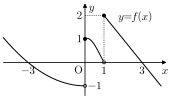

# 블라인드 출제 17번 보고서

## 문항 전문

함수 \(y=f(x)\)의 그래프가 그림과 같다.



두 실수 \(a\), \(b\)에 대하여 함수
\[
g(x)=|f(x)-a|+bf(x)
\]
가 다음 조건을 만족시킬 때, 가능한 모든 \(2a+1\)의 값의 합은? [5.2점]

> (가) 함수 \(g(x)\)가 불연속인 점은 오직 한 개이다.
>
> (나) \(g(0)-g(1)=-1\)이다.

① 4　　② 5　　③ 6　　④ 7　　⑤ 8

**정답: ⑤ 8**

## 풀이

그림에서 \(f\)는 \(0,1\) 이외의 점에서 연속이다. 두 점에서의 좌극한, 우극한, 함숫값은 각각 \((-1,1,1)\), \((0,2,2)\)이다. 따라서 \(g\)도 이 두 점 이외에서는 연속이다.

\(g\)가 \(x=0\)에서 연속일 조건과 \(x=1\)에서 연속일 조건은 각각
\[
b=\frac{|a+1|-|a-1|}{2},\qquad
b=\frac{|a|-|a-2|}{2}
\]
이다. 조건 (가)는 이 중 정확히 하나만 성립한다는 뜻이다. \(a\le-1\) 또는 \(a\ge2\)에서는 두 우변이 같으므로 두 점에서 모두 연속이거나 모두 불연속이다. 따라서 \(-1<a<2\)이다.

조건 (나)에서
\[
b=1+|1-a|-|2-a|
=\begin{cases}
0&(-1<a\le1),\\
2a-2&(1<a<2)
\end{cases}
\]
이다. 이를 두 연속 조건과 결합한다.

| 범위 | (나)에서 정해지는 b | 연속성 판정 | 가능한 (a,b) |
|---|---|---|---|
| \(a\le-1\) | — | 두 연속 조건이 같아 (가)에 맞지 않음 | 없음 |
| \(-1<a\le0\) | \(0\) | 1에서는 불연속. 0에서 연속이려면 \(b=a\) | \((0,0)\) |
| \(0<a\le1\) | \(0\) | 0에서는 불연속. 1에서 연속이려면 \(b=a-1\) | \((1,0)\) |
| \(1<a<2\) | \(2a-2\) | 0에서 연속이면 \(2a-2=1\). 1에서 연속이면 \(a=1\)이 되어 범위를 벗어남 | \((\frac32,1)\) |
| \(a\ge2\) | — | 두 연속 조건이 같아 (가)에 맞지 않음 | 없음 |

가능한 \(a\)는 \(0,1,\frac32\)이고, 서로 다른 \(2a+1\)의 값은 \(1,3,4\)이다. 따라서 구하는 합은 \(8\)이다.

## 원문 직접 풀이

- **설정:** 구간별 함수 \(f\)의 그래프와 최고차항의 계수가 1인 삼차함수 \(g\).
- **판정 원리:** 모든 \(-3<a<3\)에서 몫 \(g/f\)의 유한한 극한이 존재하도록 분자의 영점 및 영점에서의 변화율을 제한한다.

원문에서 \(x\to0-\), \(x\to0+\)일 때 분모의 극한은 각각 \(-1,1\)이다. 몫의 좌우극한이 같으므로 \(-g(0)=g(0)\), 즉 \(g(0)=0\)이다.

중간 삼차 조각을 \(q(x)\)라 하면 \(q(1)=0\)이다. 원문에 주어진 세 인수가 서로 다르므로 \(q(x)=(x-1)h(x)\), \(h(1)\ne0\)이다. \(x\to1-\)에서 몫의 극한이 유한하려면 \(g(1)=0\)이어야 한다. 이때 \(x\to1+\)에서 몫의 극한은 \(0\)이다. 따라서 \(g(x)=(x-1)r(x)\)로 놓으면 \(r(1)/h(1)=0\), 즉 \(r(1)=0\)이어야 한다. 이는 \(g'(1)=0\)과 같다.

최고차항의 계수가 1이고 차수가 3이므로 \(g(x)=x(x-1)^2\)이다. 그래프상 나머지 구간에서는 분모가 0이 아니므로 극한 조건도 충족한다. 따라서 **원문 정답은 \(g(3)=12\)**이다.

## DESIGN 요약

- **평가 요소:** 함수의 극한과 연속을 유지한다. 좌우극한과 함숫값을 비교하는 과정이 필수이며, 별도 방정식의 실근 개수 문항으로 바꾸지 않았다.
- **유지한 축:** 원문 \(f\)의 그래프. 원본 `fig_L42.svg`를 그대로 사용한다.
- **교체한 축:** 미지수를 결정하는 원리. 몫의 극한으로 삼차함수를 확정하는 대신, 두 후보점 중 한 점에서만 연속인 경우를 가린다.
- **함수 교체:** 보조함수 \(g\)를 \(|f-a|+bf\)로 한 번 교체한다. 합성을 반복하거나 새로운 그래프를 추가하지 않는다.
- **조건:** 개수 조건 (가)와 보조 수치 조건 (나)의 두 개. 본문에는 별도의 범위·부호·정수 조건이 없다.
- **새 핵심 단계:** 두 연속 조건의 배타적 성립으로 범위를 제한 → 수치 조건과 결합하여 경우 및 경계 판정 → 서로 다른 값들을 합산.
- **경우 분기:** 해설은 다섯 범위, 검증은 네 경계를 별도로 분리한 아홉 경우이다.
- **경계 함정:** \(a=0,1\)을 누락하지 않는다. \(1<a<2\)의 식에서 얻은 \(a=1\)을 다시 세면 안 된다.
- **구하는 것:** 값의 합이다. 최댓값·최솟값은 묻지 않는다.
- **원문 요소 유지:** 그래프·보조함수의 꼴·판정 장치·질문의 네 요소 중 그래프 한 요소를 유지했다고 분류하면 25%이다. 이는 출제자의 분류이다.

| 원문 핵심 단계 | 변형의 핵심 단계 | 원문 계산·결론의 직접 재사용 |
|---|---|---|
| 0에서 몫의 극한을 비교하여 \(g(0)=0\) | 두 점에서의 연속 조건을 구하고 정확히 하나만 성립하게 함 | 없음 |
| 1에서 분자의 인수 \((x-1)^2\)를 강제 | 함숫값 차와 절댓값의 구간별 식을 결합 | 없음 |
| 최고차항 조건으로 삼차함수를 확정하고 \(g(3)\) 계산 | 경계를 구분하여 가능한 \(a\)와 변환된 값의 합을 계산 | 없음 |

같은 극한·연속 개념과 그래프 수치를 사용하는 것은 유지한 평가 요소이다. 원문 핵심 결론이나 인수 결정 과정을 그대로 사용하는 단계는 0개로 자체 판정했다. 구조 거리의 설계 추정은 **0.80**이며, 독립 검토자가 측정한 점수는 아니다.

## 검증 결과

실행 명령:

```bash
PYTHONDONTWRITEBYTECODE=1 python3 verify17.py
```

실행 결과: 종료 코드 0, 마지막 줄 **`ALL OK`**.

검증에서는 절댓값 내부 식의 영점 \(-1,0,1,2\)를 경계로 실수 전체를 분할한다. 각 열린구간에 다른 부호 변화점이 없음을 확인하고, 수치 조건으로 \(b\)를 소거한 뒤 두 연속 조건의 모든 영점을 구한다. 표본 수치 탐색이 아니라 각 구간의 식에 대한 정확한 해집합 계산이다.

| 검사 | 결과 |
|---|---|
| 실수 전체 아홉 경우 전수 | \((a,b)=(0,0),(1,0),(\frac32,1)\)만 가능 |
| 정답 유일성 | 서로 다른 \(2a+1\)의 값은 \(1,3,4\), 합은 8 |
| 극한 교차 확인 | 위 세 쌍 모두 0과 1 중 정확히 한 점에서 불연속 |
| 선지 | 4, 5, 6, 7, 8; 공차 1; 정답 정확히 한 번 |
| 오답 근거 | 네 오답 모두 계산한 오류 값과 일치 |
| 원문 | \(g(x)=x(x-1)^2\), \(g(3)=12\) 확인 |
| 국소 형식·말투 | 첫 문장, 그림 경로, 배점, 상자 앞 질문, 조건 수, 금지 표현, 부등호 이스케이프 확인 |

조건 빼 보기 출력:

```text
ABLATION (가): 필요(삭제하면 모든 실수 a가 가능하여 유한한 값의 합이 정해지지 않음)
ABLATION (나): 필요(삭제하면 0<a<1, b=a가 모두 가능하여 유한한 값의 합이 정해지지 않음)
```

(가)를 지우면 모든 실수 \(a\)에 대해 \(b=1+|1-a|-|2-a|\)가 (나)를 만족시킨다. (나)를 지우면 \(0<a<1\), \(b=a\)인 연속적인 매개변수족이 (가)를 만족시킨다. 두 경우 모두 원래의 유한한 값의 합이 정해지지 않는다. 본문의 그래프와 함수식은 정의 자료이고, 추가로 부여한 제한 조건은 없다.

오답의 구체적 근거는 다음과 같다.

| 선지 | 오류 | 계산 |
|---|---|---|
| ① 4 | \(1<a<2\)인 경우를 누락 | \(1+3=4\) |
| ② 5 | 경계 \(a=1\) 제외 | \(1+4=5\) |
| ③ 6 | 상수항 1을 한 번만 합함 | \(2(0+1+\frac32)+1=6\) |
| ④ 7 | \(a=0\) 누락 | \(3+4=7\) |

**검증 범위의 한계:** 이 폴더에 공식 `dupcheck`, `fmtcheck`, `stylecheck` 도구와 비교 자료가 없다. 폴더 밖 파일을 읽지 말라는 지시에 따라 해당 검사는 시행하지 않았다. 독립 검토자의 구조 검토도 미실시이다. 따라서 골격 점수 0.60 미만이나 공식 검사 관문 전체 통과를 주장하지 않는다. 국소 형식 검사와 수학 검증의 통과 결과만 위에 기록했다.

## 원문 대비 난도 판단

원문은 두 특이점에서 분자의 인수를 결정하는 발상이 중심이고, 변형은 두 연속 조건 중 정확히 하나가 성립해야 한다는 해석과 경계 구분이 중심이다. 변형의 대수 계산은 절댓값을 풀어 얻는 일차식에 그친다. 불연속점 개수, 바깥 범위 제외, 조건 결합, 경계의 포함 여부를 판단해야 하므로 **체감 난도 5.5/10, 상위권 예상 5–7분**으로 설계했다. 원문과 비교하여 계산 부담은 줄이고 경우 판단을 늘렸다. 이 시간과 난도는 풀이 패널의 실측값이 아닌 출제자 추정이다.

## 결과 파일

- `p17.py`: 문항, 해설, 빠른 풀이, 오답 근거, DESIGN.
- `verify17.py`: Sympy 전수 검증, 조건 빼 보기, 원문 정답 및 국소 형식 확인.
- `REPORT.md`: 문항 전문과 출제·검증 보고서.

원본 그림은 수정하지 않았으며 PDF는 빌드하지 않았다.
